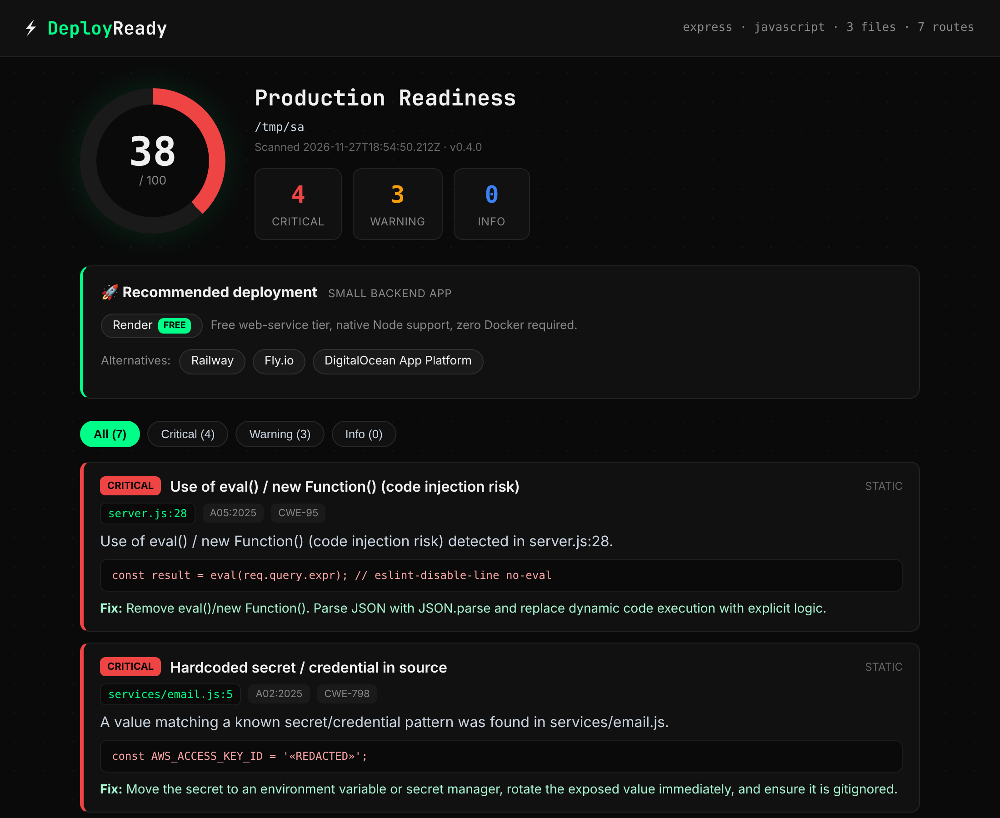

# DeployReady

DeployReady is a local security and production-readiness scanner for apps built with AI coding tools. It reads your code, optionally tests your app running on localhost, and gives a 0-100 readiness score with fixes.

```bash
npx deployready@latest
```

Requires Node.js 18 or later. Use `@latest` because plain `npx deployready` can reuse a cached older copy. To install globally instead: `npm install -g deployready`, then run `deployready`.

<p align="center">
  
</p>

<p align="center"><sub>HTML report (<code>--html</code>) for the deliberately vulnerable <a href="tests/sample-app"><code>tests/sample-app</code></a>.</sub></p>

## Quick start (about 60 seconds)

```bash
# 1. Scan. Static only, fully offline:
npx deployready@latest analyze ./my-app --no-ai --no-dynamic

# 2. Apply the safe, deterministic fixes (backups are written first):
npx deployready@latest analyze ./my-app --no-ai --no-dynamic --fix
#    in the interactive session the same thing is: fix --all

# 3. Let your coding agent scan, fix and verify in a loop (Claude Code):
claude mcp add deployready -- npx -y deployready@latest mcp
```

Run `npx deployready@latest` with no arguments to open the guided interactive session instead.

<p align="center">
  
</p>

<p align="center"><sub>A real run on <a href="benchmark/corpus/vibe/flask-debug-sqli-tp"><code>benchmark/corpus/vibe/flask-debug-sqli-tp</code></a> (paths shortened, repeated lines elided). Only the two findings with a safe deterministic fix are changed; the rest are left for you or your coding agent.</sub></p>

## What it checks, and what it doesn't

**Checks**

- Static analysis of JavaScript/TypeScript and Python: hardcoded secrets, `eval`, command and SQL injection, XSS sinks, weak crypto, disabled TLS verification, insecure cookies, JWT `none`, unsafe deserialization, committed `.env`. Findings map to OWASP Top 10 (2025) and CWE.
- Access control patterns: routes without an auth check, Supabase tables without Row-Level Security, `service_role` keys in client code.
- Live checks against your app on localhost: auth bypass, exposed admin routes, secrets in responses, CORS, security headers, rate limiting.
- Opt-in active (authenticated) tests and Supabase checks, described below.
- Firebase security rules (static only): open or test-mode Firestore/Storage/Realtime Database rules, sign-in-only rules on user-owned paths, and committed service account keys. See [`docs/FIREBASE.md`](docs/FIREBASE.md).

**Does not**

- It is not a penetration test or a substitute for a code review. A score of 100 means none of these checks fired, not that the app is secure.
- Static analysis has false positives and false negatives. Business-logic flaws, most authorization design errors, and anything in languages other than JS/TS/Python are out of reach.
- Live tests only cover routes your code or OpenAPI file defines, plus links your running app advertises. Paths are not guessed unless you opt in to the common-path probe.
- AI-generated findings are marked unverified and never change the score or the CI gate.
- Supabase checks are read-only, so write exposure (INSERT/UPDATE/DELETE policies) is not tested.
- Firebase checks read the rules files in your repo only. They do not connect to Firebase, so deployed rules and Auth settings are not verified. The public web config `apiKey` is not flagged.

Test coverage numbers are in [`docs/COVERAGE.md`](docs/COVERAGE.md).

## Score badge

```bash
npx deployready@latest badge .                        # prints a markdown badge
npx deployready@latest badge . --write-svg badge.svg  # also writes a local SVG, no network
```

The command runs a static scan and prints, for example:

```markdown

```

Colors: 90-100 bright green, 75-89 green, 60-74 yellow, 40-59 orange, below 40 red. The badge is a snapshot; regenerate it when the score changes.

## Install

See the top of this page. Every command here is written as `npx deployready@latest ...`; with a global install, use `deployready ...`.

## Interactive commands

Once a session is open, you can drive it directly:

```
deployready › scan        # full pipeline: parse → live tests → optional AI
deployready › issues      # list findings, numbered
deployready › show 3      # full detail of finding #3
deployready › fix 3       # auto-fix, or an AI-proposed diff you approve (backup created)
deployready › verify 3    # re-run the checks to confirm a fix worked
deployready › done 3      # mark fixed (score updates live)
deployready › open        # open the HTML dashboard in your browser
deployready › exit
```

| Command | What it does |
|---|---|
| `scan` · `parse` · `dynamic` · `ai` | run the whole pipeline, or one step at a time |
| `issues [crit\|warn\|info]` · `show <n>` | list findings (optionally filtered) · show one in detail |
| `fix <n>` | deterministic auto-fix where safe (weak hashes, disabled TLS verification, `yaml.load`, `verify=False`, Flask `debug=True`, gitignore `.env`); otherwise an AI-proposed diff you approve (creates a backup); otherwise guidance |
| `fix --all` | apply every safe deterministic fix above in one go: one confirmation, a backup per change, each one re-verified. AI-proposed fixes are never run in bulk |
| `verify <n>` | re-run the relevant checks to confirm a fix actually resolved the issue |
| `done <n>` · `ignore <n>` | mark fixed / ignored — the score recomputes immediately |
| `score` · `status` | show the current readiness score / session state |
| `deploy [platform]` | recommend a host for this project (no arg) or print a step-by-step guide for a chosen one (`aws`, `do`, `vercel`, `render`, `railway`, `fly`, `netlify`) |
| `export` · `open` | write `deployready-report.md` · open the HTML dashboard |
| `config` · `help` · `menu` · `clear` · `exit` | session utilities |

## One-shot (CI / scripting)

```bash
npx deployready@latest init                              # first-time setup (pick model, store key)
npx deployready@latest analyze ./my-app                  # single non-interactive scan, prints results
npx deployready@latest analyze . --no-ai --no-dynamic    # static only, fully offline
npx deployready@latest report ./my-app                   # scan and export the markdown report
npx deployready@latest badge ./my-app                    # print a markdown score badge
npx deployready@latest config                            # show the active config (secrets never printed)
```

**Flags for `analyze`:**

| Flag | Effect |
|---|---|
| `-y, --yes` | auto-approve all prompts (non-interactive) |
| `--fix` | apply the safe deterministic fixes (backed up), re-scan, and report the new score; works with `--json` and `--fail-on` (asks once unless `--yes`/`--json`) |
| `--no-dynamic` | skip live localhost testing |
| `--no-ai` | skip AI analysis (local results only) |
| `--aggressive` | enable aggressive tests (rate-limit burst) |
| `--export` | write `deployready-report.md` |
| `--html` / `--open` | write an HTML dashboard / and open it in your browser |
| `--json` | print a machine-readable JSON report (implies `--yes`) |
| `--fail-on <severity>` | exit non-zero if findings at/above `critical \| warning \| info \| none` exist |
| `--baseline <file>` | gate only on findings **not** in the baseline file (existing issues are grandfathered) |
| `--strict-baseline` | with `--baseline`, also fail on stale suppressions (entries with no matching finding) |
| `--write-baseline <file>` | write the current findings to a baseline file and exit `0` (accept current state) |
| `--active` | run **active** authenticated authorization tests (needs `--token`; consented, loopback-only unless `--i-own-this-target`) |
| `--token <jwt>` | bearer JWT for the active scan (your logged-in test user) |
| `--token-b <jwt>` | a second user's JWT — enables tenant / IDOR isolation tests |
| `--active-url <url>` | base URL for the active scan (default: the app found on localhost) |
| `--i-own-this-target <host>` | confirm you own a non-loopback host so active probes may target it (repeatable, exact host) |
| `-v, --verbose` | verbose debug output |

**CI gate:** exit codes are `0` (clean), `2` (gate failed), `1` (tool error).

```bash
npx deployready@latest analyze . --no-ai --no-dynamic --fail-on critical
```

**Grandfather existing issues (baseline):** adopt the current findings once, then fail the
build only on *new* ones — so you can turn the gate on for an existing codebase without
drowning in pre-existing debt:

```bash
npx deployready@latest analyze . --no-ai --no-dynamic --write-baseline .deployready-baseline.json   # once
npx deployready@latest analyze . --no-ai --no-dynamic --baseline .deployready-baseline.json --fail-on warning  # in CI
```

Baseline v2 (diff-friendly, sorted JSON, safe to commit) identifies a finding by rule, path, endpoint, enclosing function/route, a normalized line context (string contents replaced by a length class, so no secret or secret hash is stored) and an occurrence index. Moving code does not re-fail the build; a second secret in the same file, an escalation (warning to critical), a resolved issue that comes back, or an expired suppression all do. Each entry carries `severity`, `acceptedAt`, `reason`, `owner` and optional `expiresAt` (edit these by hand; `--write-baseline` preserves them). The gate prints new / escalated / reopened / expired / stale counts; `--strict-baseline` also fails on stale suppressions. Old v1 baselines still load (with a warning) until you re-run `--write-baseline`. See [`docs/BASELINE.md`](docs/BASELINE.md).

**GitHub Action:** gate pull requests, get a sticky PR comment and code-scanning alerts (SARIF) with one step. Needs `security-events: write` and `pull-requests: write`:

```yaml
permissions: { contents: read, security-events: write, pull-requests: write }
steps:
  - uses: actions/checkout@v4
  - uses: BelsoftSolutions/deployready@v0.4.0
    with: { fail-on: critical }
```

Details in [`docs/GITHUB-ACTION.md`](docs/GITHUB-ACTION.md); a full example is in [`docs/github-action-example.yml`](docs/github-action-example.yml). Locally, `--sarif <file>` writes a SARIF 2.1.0 report.

### Fix in one command (`--fix`)

```bash
npx deployready@latest analyze . --no-ai --no-dynamic --fix --yes         # apply safe fixes, re-scan, print the new score
npx deployready@latest analyze . --no-ai --no-dynamic --fix --json --fail-on critical
```

`--fix` only applies deterministic fixes (for example adding `.env` to `.gitignore`, or swapping a weak hash for SHA-256). Every change is backed up first. With `--json`, the report gains a `fix` block (`applied`, `skipped`, `scoreBefore`, `scoreAfter`) and `--fail-on` gates on the post-fix result.

## Use it from your coding agent (MCP)

`deployready mcp` is a local stdio [MCP](https://modelcontextprotocol.io) server. Your own coding agent (Claude Code, Cursor, Codex, Windsurf) scans, fixes, and has DeployReady verify, in a loop. Nothing leaves your machine, and the server never calls an AI model itself.

| Tool | What it does |
|---|---|
| `scan(path?, dynamic?)` | findings (id, rule, severity, file, line, evidence, proof) plus the score |
| `get_finding(id)` | full detail, fix guidance (recommendation, OWASP, CWE) and the whole file with the line marked |
| `apply_safe_fixes(path?)` | runs the deterministic fixes; returns applied/skipped with backup paths |
| `verify(id)` | re-checks one finding: `fixed`, `still-present` or `inconclusive`, with the reason |
| `score(path?)` | re-scans; score plus a ready/not-ready verdict (ready = no open critical findings) |
| `supabase_check(path?, live?, crossUser?)` | Supabase checks; live checks only for a local or proven-owned project, credentials from env only (see docs/SUPABASE.md) |

The loop: `scan` -> `apply_safe_fixes` -> fix the rest with the agent's own edits (using `get_finding`) -> `verify` each -> `score`.

**Claude Code**

```bash
claude mcp add deployready -- npx -y deployready@latest mcp
```

**Live and active findings need test tokens.** `scan(dynamic: true)` and `verify` for live findings (including the token-based IDOR / JWT / escalation checks) read the test identities from the MCP server's environment: `DEPLOYREADY_TOKEN` (and `DEPLOYREADY_TOKEN_B` for the second identity). The tools accept no secrets as arguments, and tokens are never logged or echoed (proofs show `$TOKEN` placeholders). Without them, active findings stay `inconclusive`.

```bash
claude mcp add deployready -e DEPLOYREADY_TOKEN=<test-user-jwt> -e DEPLOYREADY_TOKEN_B=<second-user-jwt> -- npx -y deployready@latest mcp
```

The interactive shell's `verify` reads the same two variables.

A ready-made Claude Code skill that teaches the loop is in [`skills/deployready/SKILL.md`](skills/deployready/SKILL.md) (copy it to `.claude/skills/deployready/`).

**Cursor** (`.cursor/mcp.json`)

```json
{
  "mcpServers": {
    "deployready": { "command": "npx", "args": ["-y", "deployready@latest", "mcp"] }
  }
}
```

**Any other MCP client** (Codex, Windsurf, ...): add the same server to its `mcpServers` config.

```json
{
  "mcpServers": {
    "deployready": { "command": "npx", "args": ["-y", "deployready@latest", "mcp", "/path/to/project"] }
  }
}
```

The optional trailing path sets the default project for tool calls (default: the current directory).

### Active (authenticated) testing — "try to hack it"

With your app running locally, DeployReady can act as a logged-in user and try to break access control — the checks you'd otherwise do by hand in Burp/Postman:

```bash
npx deployready@latest analyze . --active --token "<your-JWT>" --token-b "<second-user-JWT>"
```

- **Broken object-level auth (IDOR/BOLA)** — swaps resource ids to reach another user's data.
- **Broken tenant isolation** — swaps `org_id`/tenant to reach another tenant's data.
- **Privilege escalation** — forges a `role: admin` claim and checks whether a forbidden route opens up.
- **JWT not verified** — checks whether the server accepts a forged `alg:none` token.
- **Unauthenticated write routes** — sends each discovered `DELETE`/`PATCH` route once with **no credentials**, aimed at a record id that cannot exist (`__deployready_probe_<random>__`), with no body. A `2xx` (when a random-path control does not also answer `2xx`) means the route handles writes for anonymous callers; `401`/`403` means auth is enforced; anything else is not reported.

It is **opt-in and consented** and **loopback-only**. The tampering checks are GET-only. The write-route probe never addresses real data: it only probes routes whose every path parameter can be filled with a non-existent id, skips routes without a parameter (e.g. `DELETE /api/session`), skips `PUT` (often an upsert, so it could create data), and never runs on a non-loopback host. Need a token? Run `--active` without one and DeployReady prints step-by-step instructions for grabbing your JWT from the browser.

Every live finding carries **proof**: a copy-pasteable `curl` command (your tokens appear only as `$TOKEN` / `$TOKEN_B`), the status, a truncated response and the control request that shows the endpoint otherwise works, all redacted. It appears in `show`, the terminal report, the markdown/HTML reports and `--json`. `verify` reports `fixed` only with proof (the attack fails **and** a control request still works); otherwise it says `inconclusive` and why.

To run active probes against a host you own that is not on your machine (e.g. staging), name it explicitly: `--active-url https://staging.example.com --i-own-this-target staging.example.com` (repeatable; or `"ownedTargets": ["staging.example.com"]` in your config). Only that exact host is allowed — no wildcards or subdomains — and the write-route probe still stays loopback-only.

### Route discovery (on by default, nothing guessed)

**OpenAPI/Swagger from disk.** DeployReady reads `openapi.*` / `swagger.*` (JSON or block-style YAML) files in your project and treats their paths as routes, with the spec's `security` as the guard evidence. No request is needed to read them, and it works for stacks without a code parser.

**Advertised links.** From pages it already fetched from those routes, DeployReady also follows up to 25 same-origin GET links your running app advertises (`<a>`, `<link>`, `Link:` headers, and a `robots.txt`/`sitemap.xml`/OpenAPI document only if your project or a response points at it), one level deep, never logout/delete-style links. Details: [`docs/ROUTE-DISCOVERY.md`](docs/ROUTE-DISCOVERY.md).

### Common-path probe (opt-in)

By default the live tests never guess paths. With `--probe-common-paths` (or `"probeCommonPaths": true` in your config, interactive runs only) DeployReady also requests a fixed list of 16 well-known paths such as `/.env` and `/.git/config` from your local app, at most 20 GET requests, after showing you the list and asking first. A path is reported only when its content proves it (a `200` alone is never enough), and findings are labelled as guessed, lower confidence, in their own report section. In `--yes`, `--json` and CI only the explicit flag enables it. Details: [`docs/COMMON-PATH-PROBE.md`](docs/COMMON-PATH-PROBE.md).

## How it works

```
parse → static scan → (you approve) live localhost tests → aggregate + score
      → (you approve) AI analysis of findings JSON → terminal report → export
```

Only the **structured findings JSON** is ever sent to an AI — and only after you approve, with all secrets redacted first. With Ollama, nothing leaves your machine at all.

## AI models (optional)

DeployReady works fully offline with no AI. To enable deeper analysis, configure one via `npx deployready@latest init`:

| Model | Notes |
|---|---|
| Claude API (Anthropic) | Set `ANTHROPIC_API_KEY` or store via `init`. Default: `claude-sonnet-4-6`. |
| OpenAI API | Set `OPENAI_API_KEY` or store via `init`. |
| Ollama (local) | Fully offline, no key — nothing leaves your machine. |
| Claude (CLI login) | Uses your own installed `claude` CLI and **your own Claude plan** — no API key. See below. |
| Codex (CLI login) | Uses your own installed `codex` CLI and **your own ChatGPT/OpenAI plan** — no API key. See below. |

### CLI-login providers (Claude / Codex)

Choose these in `init` (or in the interactive menu under "Set up or change the AI model") if you already use the `claude` or `codex` command-line tool and prefer that login to an API key.

- **Login status** is read from the CLI itself (`claude auth status`, `codex login status`). If the CLI is installed but not logged in, DeployReady offers to run the CLI's own login command (`claude auth login` / `codex login`) in your terminal. You sign in inside that tool: DeployReady never sees, reads, copies or stores your token or the CLI's auth files.
- **Your plan's rules apply, not the API terms.** Data is handled under the data policy of your own plan and counts against your plan's usage allowance. The consent prompt says so before anything is sent.
- **Same data as the API providers:** only the redacted structured findings report (or, for `fix`, one redacted snippet you confirm first). Never your source files.
- **Text in, text out.** The CLI is started with its tools disabled, from an empty temporary folder, with a minimal environment, and its answer is treated as untrusted text. It is never asked to edit your files. When you accept a fix, DeployReady applies it with its own editor: a backup is written to `.deployready/backups/` first, the path is confined to your project and the result is syntax-checked.
- AI findings stay marked unverified and never change your score or the CI gate.
- **Codex can be switched off.** To disable the Codex provider, set `"codexEnabled": false` in `~/.deployready/config.json`; it then refuses to run and sends nothing. The Claude provider has no such switch.
- These providers are meant for interactive, local use. Each call uses your own plan allowance.

## Security & privacy

To report a vulnerability in DeployReady itself, see [SECURITY.md](SECURITY.md). DeployReady reads your code, probes your ports and can hold API keys, so:

- API keys are read from environment variables first and **never logged**; the on-disk config is written with `0600` permissions.
- All terminal output and any AI payload pass through a central **secret redactor**.
- Dynamic testing is **loopback-only** and **GET-only** by default; aggressive tests require explicit consent. It only requests routes your code (or your OpenAPI/Swagger file) defines, plus up to 25 same-origin paths your running app itself advertises in pages it already served (links, `Link:` headers, and a `robots.txt`/`sitemap.xml`/OpenAPI document only if your project or one of those responses points at it; one level deep, never logout/delete-style links) — it never guesses paths like `/admin` or `/.env`, and never invents ids for routes with path parameters (those are listed as "could not check"). Use `--verbose` to see every request decision.
- File scanning is confined to the project root, with symlink/traversal protection and size caps.

## Configuration

Config lives at `~/.deployready/config.json` — see [`docs/sample-config.json`](docs/sample-config.json). Prefer environment variables for API keys.

## Development

```bash
npm install
npm run build      # tsc -> dist/
npm test           # jest
npm run dev        # run from source via tsx
```

## Contributing

Issues and PRs welcome — see [CONTRIBUTING.md](CONTRIBUTING.md).

---

_Belal · Belsoft Solutions · MIT License_
